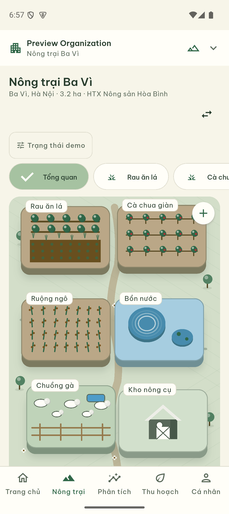
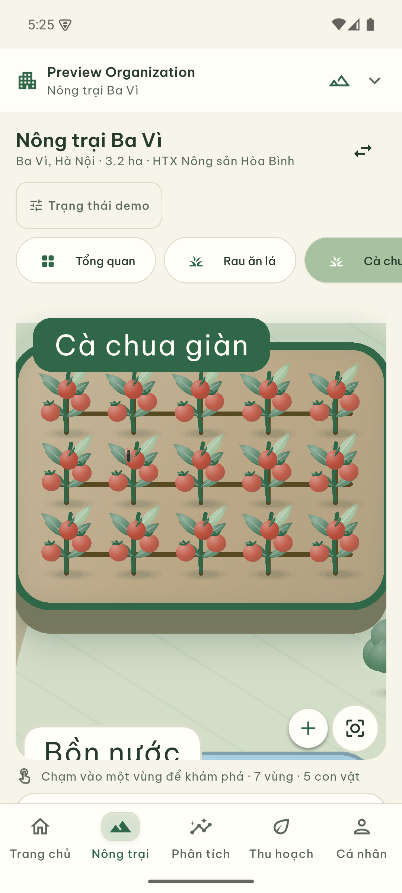
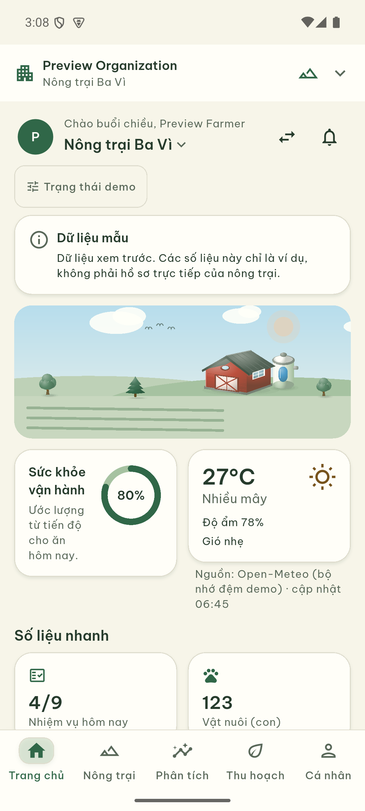
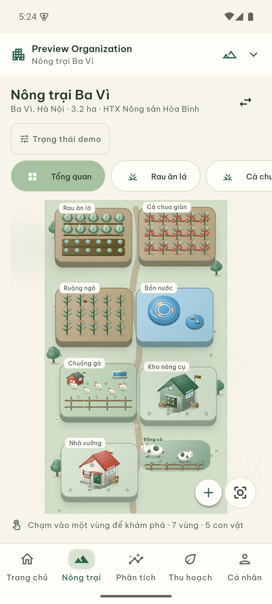
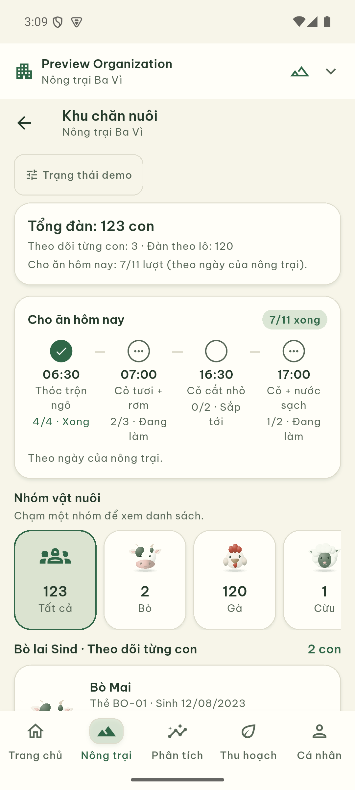
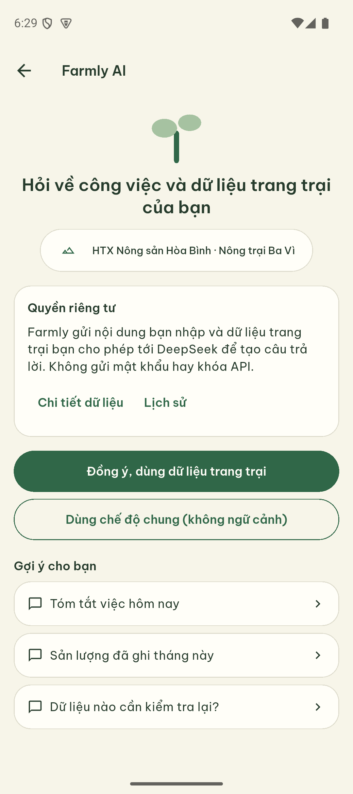
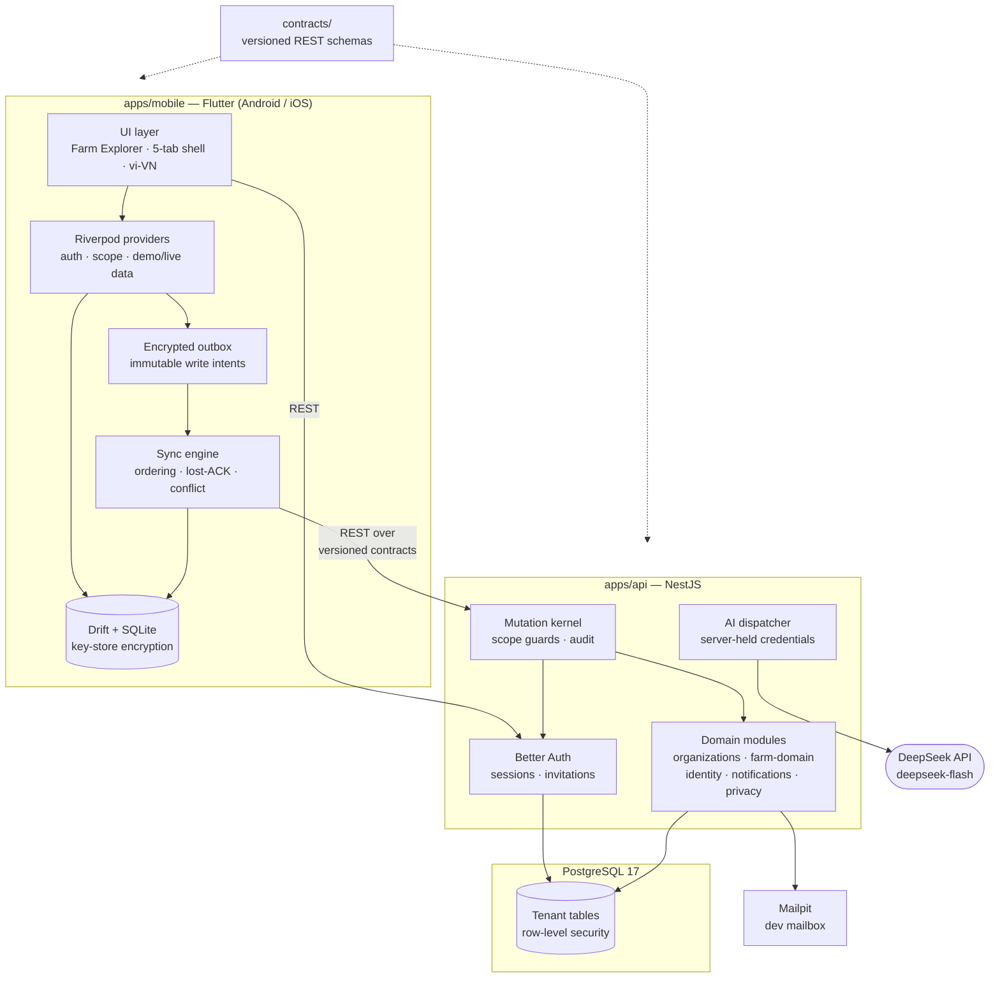
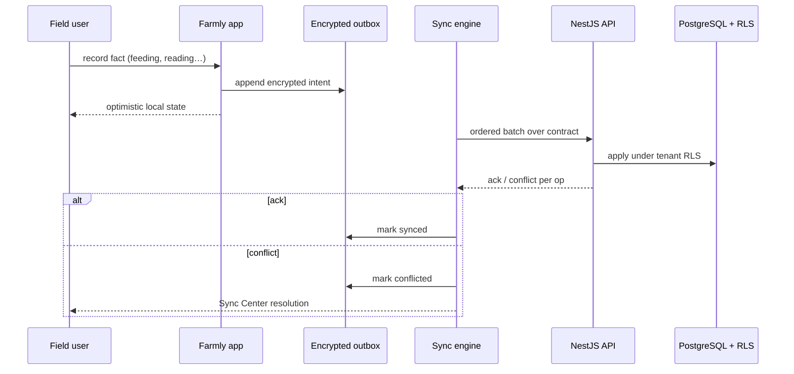

# Farmly


**Offline-first farm operations platform** — a Flutter mobile app backed by a
multi-tenant NestJS + PostgreSQL API. Farmly lets cooperatives manage crops,
livestock, water, tasks and harvests across organizations and farms — in the
field, with or without connectivity.

<p align="center">
  
  
  
</p>
<p align="center">
  
  
  
</p>

## Highlights

- **Interactive farm map** — board-style extruded 3D plots with animated,
  clay-style 3D trees, crops and species-aware farm animals. Soft directional
  lighting, rounded foliage, wool and warm animal portraits share one visual
  language. Houses, storage sheds and barns use solid roof/wall planes, inset
  openings and contact shadows; shared cards and controls use restrained depth.
  Trellised tomatoes, corn rows, lettuce beds, ponds and barns retain
  their own illustrated detail;
  rooted grass sways in the wind while pasture animals take short, staggered
  walks with alternating steps and turns inside their own lanes. This motion
  shares the existing battery-conscious scene loop,
  with reduced-motion still poses and a smooth camera dive into any plot.
  Tap the meadow to watch walking cows up close without changing livestock records;
  houses and tool sheds open their own details with one tap, and fish swim in
  the water scene. Roof shingles, porches, tools and yard furniture add depth;
  wind pennants, roof ventilation, chimney wisps, drifting water lilies and
  butterflies give each zone its own ambient detail.
- **Offline-first writes** — every operation is captured in an immutable
  encrypted outbox on-device and synced when connectivity returns, with
  dependency-aware ordering and conflict recovery.
- **True multi-tenancy** — organizations → farms → zones, enforced by
  PostgreSQL row-level security plus server-side guards.
- **Farmly AI** — contextual assistant (DeepSeek `deepseek-flash`) that
  reasons over the caller's own farm data; credentials stay server-side and
  the app asks for explicit consent before sending farm context.
- **Honest data** — every number carries provenance (sensor/manual/derived)
  and freshness; nothing is silently invented.

## System architecture



## Offline-first sync

Every field write is captured as an immutable intent in the device-side
outbox — never lost on crash, kill, or connectivity drop. The sync engine
replays intents dependency-aware, reconciles lost acknowledgements, and
routes conflicts to the Sync Center for human resolution:



## Repository layout

| Path | Contents |
|---|---|
| `apps/mobile` | Flutter app — features, core (sync/storage/auth), goldens |
| `apps/api` | NestJS API — modules, Prisma migrations, migration scripts |
| `contracts` | Versioned request/response schemas + generator |
| `infra` | Docker Compose dev stack (PostgreSQL 17, Mailpit) |
| `tools/qa` | Dependency-pin, secrets and preflight checkers |
| `tools/eval` | Chatbot eval set, oracles and runner |
| `docs` | Screenshots |

## Getting started

### API

```powershell
cp infra/.env.example infra/.env        # fill unique local-only secrets
docker compose -f infra/compose.yaml --env-file infra/.env config --quiet
cp apps/api/.env.example apps/api/.env  # fill replace-me secrets to match infra/.env
npm --prefix apps/api ci
npm --prefix apps/api run start:dev
```

The API loads its config from `apps/api/.env` — the `replace-me` passwords in
`DATABASE_URL_TENANT` and `DATABASE_URL_AUTH` must match the tenant and auth
role passwords set in `infra/.env`.

The API rejects `MIGRATION_DATABASE_URL` at runtime — migration credentials
live only in the migration process. See `apps/api` scripts for the ordered
migration chain (`migrate:auth` → `migrate:tenant` → `migrate:rls` → …),
including `migrate:farm-iana-timezone-guard` for durable server-side validation
of farm timezone writes and `migrate:task-schedule-rules` for weekly task-day
requirements and unmaterialized occurrence schedule enforcement. The
`migrate:animal-tag-uniqueness` migration installs farm-local, trimmed,
case-sensitive animal tag uniqueness after a fail-closed duplicate preflight.

### Mobile

```powershell
cd apps/mobile
flutter pub get

# Regenerate gitignored code (same policy as apps/api/generated/):
node ../../contracts/scripts/build-contracts.mjs   # lib/generated/farmly_api_types.dart
flutter gen-l10n                                   # lib/l10n/generated/ (also rebuilt on every flutter build)

# Visual preview without a backend — stub session + demo farm data:
flutter run --flavor development -t lib/main_explorer_preview.dart

# Full app (needs a running API):
flutter run --flavor development -t lib/main.dart
```

The visual preview uses in-memory credentials and local API/auth adapters. It
blocks the persistent sync engine and exposes existing authentication screens
for visual inspection only. Preview navigation is not evidence of live sign-in,
backend sync or AI provider execution. No app-data reset is needed to run it.

`lib/generated/` and `lib/l10n/generated/` are generated output and are not
committed — recreate them with the commands above. `flutter gen-l10n` also
runs automatically on every build because `pubspec.yaml` sets `generate: true`.

## Verification

```powershell
npm --prefix apps/api run build
npm --prefix apps/api run test:unit
node contracts/scripts/build-contracts.mjs --check
node tools/qa/preflight.mjs --json

cd apps/mobile
flutter analyze
flutter test            # unit + widget + golden suite
```

## Project status

Foundation build in active development. Golden-tested UI for the six primary
screens, demo-data preview entrypoint, and the sync/RLS kernel are in place;
live-device journeys, live DeepSeek calls and release packaging remain gated
on credentials and hardware. The internal planning docs covering scope,
evidence and current gates are working documents and are not shipped in the
repository.
