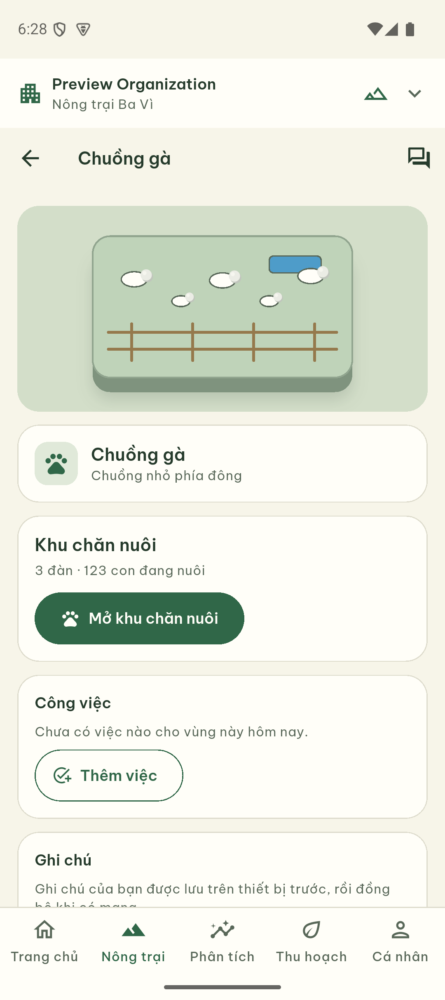
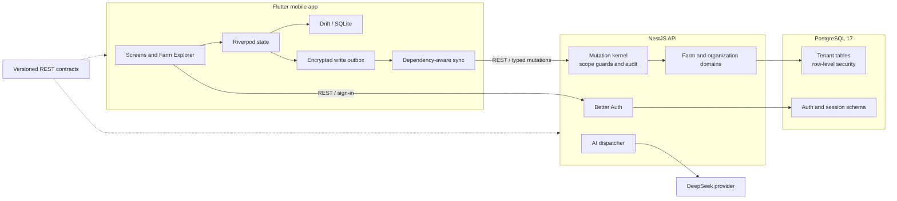

# Farmly

<p align="center">
  <strong>Offline-first farm management for cooperatives and field teams.</strong><br />
  Track crops, livestock, water, tasks and harvests across farms with a Flutter app and a multi-tenant NestJS API.
</p>

<p align="center">
  <a href="https://flutter.dev"></a>
  <a href="https://dart.dev"></a>
  <a href="https://nestjs.com"></a>
  <a href="https://www.postgresql.org"></a>
  <a href="LICENSE"></a>
</p>

Farmly is being built for teams that need a clear operational picture in the
field, including when connectivity is limited. The mobile client, API and
versioned contracts live together in this repository.

## Contents

- [Screenshots](#screenshots)
- [Product capabilities](#product-capabilities)
- [Architecture](#architecture)
- [Offline workflow](#offline-workflow)
- [Getting started](#getting-started)
- [Verification](#verification)
- [Repository layout](#repository-layout)
- [Project status](#project-status)
- [License](#license)

## Screenshots

<p align="center">
  
  
  
</p>
<p align="center"><sub>Farm Explorer · Plot camera view · Home dashboard</sub></p>

<p align="center">
  
  
  
</p>
<p align="center"><sub>Crop zone · Livestock · Pasture scene</sub></p>

<p align="center">
  
</p>
<p align="center"><sub>Farmly assistant</sub></p>

## Product capabilities

- **Farm Explorer:** an interactive, isometric-inspired map with distinct crop,
  livestock, water and building zones. The illustrated clay-style scene uses
  layered depth, animated plants and animals, and focused details for barns,
  sheds and the water area.
- **Farm operations:** organize farms and zones, and record crop, livestock,
  watering, task and harvest information through the mobile app.
- **Offline-first workflow:** supported writes can be queued in an encrypted
  on-device outbox, then synchronized in dependency order. Acknowledgement
  recovery and conflict handling are part of the sync design.
- **Organization isolation:** organizations, farm grants and tenant-scoped data
  are guarded in the API and PostgreSQL row-level security policies.
- **Contextual AI:** an online, read-only assistant can use farm context after
  explicit user consent. Provider credentials stay on the server; live use
  requires separately configured credentials and an approved budget.
- **Traceable information:** operational values retain their source and
  freshness context where the domain provides it.

## Architecture



## Offline workflow

For supported operations, the app records a typed intent in its local outbox
before synchronization. The sync engine respects operation dependencies,
reconciles lost acknowledgements, and keeps conflicts available for resolution
in the app. This describes the implemented workflow; completion of the full
Android/iOS device and release matrix is tracked separately under [project
status](#project-status).

## Getting started

### Prerequisites

- Flutter **3.38 or newer** and Dart **3.12 or newer** for the mobile app.
- Node.js **24.12.x** for the API and contract tooling.
- A configured PostgreSQL database for the full API. Docker is optional and
  only used for the repository's isolated integration-test services.

### Run the mobile preview

The preview starts the visual app with local demo data and does not require a
running backend:

```sh
cd apps/mobile
flutter pub get
node ../../contracts/scripts/build-contracts.mjs
flutter gen-l10n
flutter run --flavor development -t lib/main_explorer_preview.dart
```

The preview uses in-memory credentials and local adapters. It blocks the
persistent sync engine, so preview navigation does not verify live sign-in,
backend synchronization or an AI provider call.

### Run the full app and API

Configure `apps/api/.env` from [`apps/api/.env.example`](apps/api/.env.example)
with local-only values and connection URLs for a reachable PostgreSQL service.
Apply the required database migrations using the scripts in
[`apps/api/package.json`](apps/api/package.json), then start the API:

```sh
npm --prefix apps/api ci
npm --prefix apps/api run start:dev
```

In another terminal, run the non-preview mobile entry point:

```sh
cd apps/mobile
flutter pub get
node ../../contracts/scripts/build-contracts.mjs
flutter gen-l10n
flutter run --flavor development -t lib/main.dart
```

Never commit `.env` files or provider credentials. The Compose configuration in
[`infra/compose.yaml`](infra/compose.yaml) is for isolated integration-test
services, not a production or general-purpose database.

## Verification

The [GitHub Actions workflow](.github/workflows/ci.yml) defines API unit and
contract checks plus Flutter analysis and unit/widget/core tests. On a fresh
checkout, generate the shared client types before running API contract tests:

```sh
# From the repository root
npm --prefix apps/api ci
node contracts/scripts/build-contracts.mjs
npm --prefix apps/api run build
npm --prefix apps/api run test:unit
npm --prefix apps/api run test:contract
node contracts/scripts/build-contracts.mjs --check

# Flutter checks
cd apps/mobile
flutter pub get
flutter gen-l10n
flutter analyze --no-pub
flutter test --no-pub test/unit test/widget test/core
```

These checks do not by themselves establish live PostgreSQL integration,
provider availability, encrypted-storage restart behavior on every target,
physical-device performance or production release readiness.

## Repository layout

| Path | Purpose |
| --- | --- |
| [`apps/mobile`](apps/mobile) | Flutter app, features, local storage, sync and UI tests |
| [`apps/api`](apps/api) | NestJS API, domain modules, migrations and API tests |
| [`contracts`](contracts) | Versioned request/response schemas and client generator |
| [`.github/workflows`](.github/workflows) | GitHub Actions checks |
| [`infra`](infra) | Isolated PostgreSQL and Mailpit integration-test services |
| [`tools/qa`](tools/qa) | Dependency, secret and verification utilities |
| [`tools/eval`](tools/eval) | Farmly assistant evaluation fixtures and runner |
| [`docs/screenshots`](docs/screenshots) | Product screenshots used in this README |

## Project status

Farmly is under active development. The repository contains the Flutter client,
NestJS API, typed contracts and the illustrated Farm Explorer. Live service
configuration, full Android/iOS device acceptance, production AI-provider use
and release packaging remain separate verification gates. See
[GitHub Actions](https://github.com/JasonTM17/Farmly_Flutter/actions) for the
latest workflow results.

## License

Farmly is released under the [MIT License](LICENSE).
